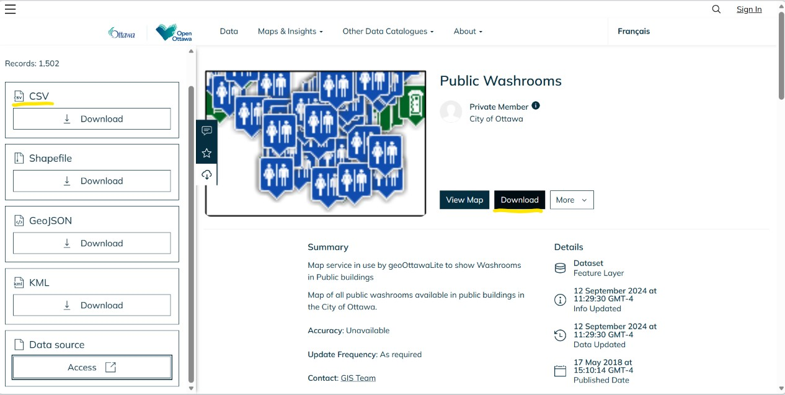
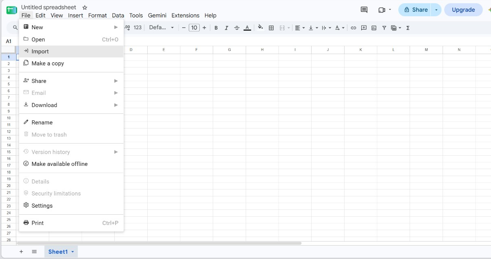
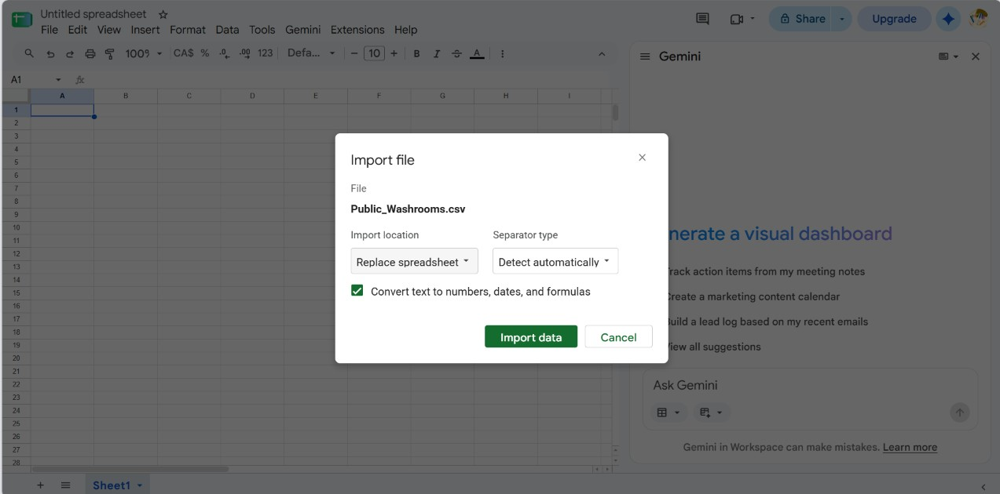
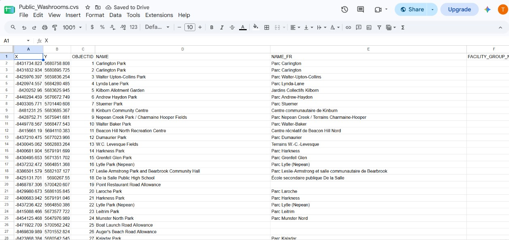
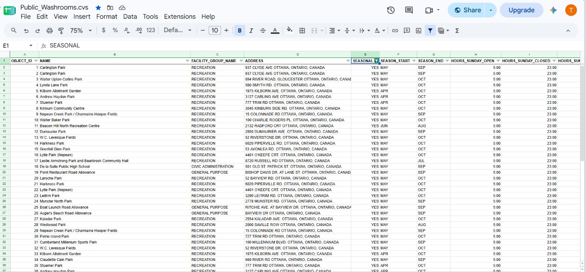
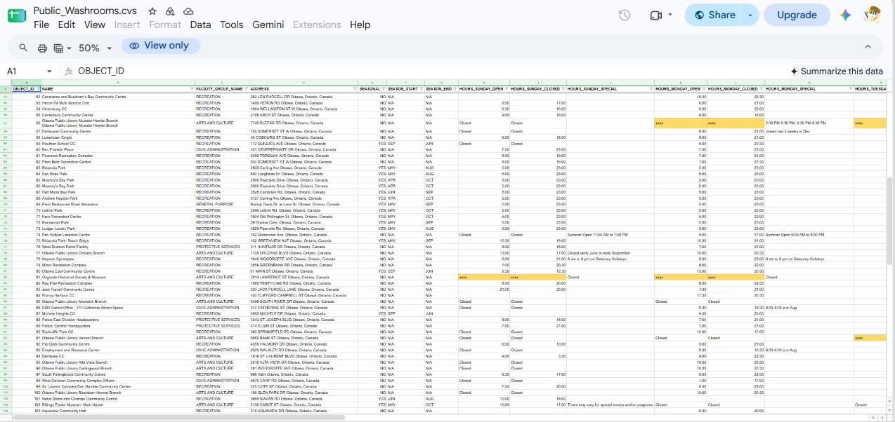

**Date:** October 29, 2026<br>
**Course:** MPAD 2003 A - Introductory Data Storytelling<br>
**Student Name:** Tessa Roberts (#101371137)<br>
**Presented to:** Jean-Sébastien Marier<br>
<br>

# Deliverable 2: Exploratory Data Analysis (EDA)

<!--Use one hashtag symbol (`#`) to create a level 1 heading like this one.

## Foreword

For this assignment, you must clean and analyze the dataset from Deliverable 1, create exploratory charts/visualizations, and identify a potential story. Your assignment must clearly detail your process. You are expected to write about 1,000-1,200 words, and to include several screen captures showing the different steps you went through. Your assignment must be written with the Markdown format and submitted on GitHub.

I have been assigning different versions of this project to my digital journalism and data storytelling students for a few years now. Its structure was inspired by the main sections/chapters of [*The Data Journalism Handbook*](https://datajournalism.com/read/handbook/one/). This version was further inspired by the [Key Capabilities in Data Science](https://extendedlearning.ubc.ca/programs/key-capabilities-data-science) program offered by the University of British Columbia (UBC).

**Here are some useful resources for this assignment:**

* [GitHub's *Basic writing and formatting syntax* page](https://docs.github.com/en/get-started/writing-on-github/getting-started-with-writing-and-formatting-on-github/basic-writing-and-formatting-syntax)
* [The template repository for this assignment in case you delete something by mistake](https://github.com/jsmarier/jou4100_jou4500_mpad2003_project2_template)

Did you notice how to create a hyperlink? In Markdown, we put the clickable text between square brackets and the actual URL between parentheses.

And to create an unordered list, we simply put a star (`*`) before each item. -->

## 1. Getting Data

The selected Dataset is the City of Ottawa's Database about <ins>[Public Washrooms](https://open.ottawa.ca/datasets/ottawa::public-washrooms/about).</ins>

**IMPORT INTO GOOGLE SHEETS:** 

**1.** Click "<ins>Download</ins>", select the CVS file option, then "<ins>Save</ins>".

*Figure 1: Downloading database from Open Ottawa.*

**2.** Open Google Sheets, Click "<ins>File</ins>", then "<ins>Import</ins>", then "<ins>Upload</ins>" to import the CSV file.

*Figure 2: CSV file import on Google Sheets.*


*Figure 3: Google Sheets "Import data" file prompt.*

**3.** Click "<ins>Import data</ins>" and now the file has been imported!

*Figure 4: First 28 rows of fully imported Database.*

**Public GoogleSheets Link:** <ins> https://docs.google.com/spreadsheets/d/1WWs_5XDITIMu7ZMi5Y0k4jcVvdXTl-t2ZMsUHL9qOp0/edit?usp=sharing </ins>

**Dataset Observations:**
The dataset appears consistent across 52 columns and 180 rows. Information starts off dense towards the left and gradually gets more spaced out the farther the columns reach the right, where most data is duplicated to adapt French translations. However the final 2 rows and columns are completely empty. 

The data features both Right and Left text alignments; with numerical data being aligned right as shown for the (-X, Y) coordinates in columns A-B and washroom opening and closing hours in columns M-AF. Meanwhile, all nominal data is aligned left like in column D for location names or column AO for their Jurisdiction.
Interestingly, the dataset features another set of (-X, Y) coordinates in columns AM-AN. Both seemingly pinpoint the washroom locations, bringing up the question of why a second coordinate system is needed when location information is already provided in columns A-B.

While specified information helps to differentiate data types, duplicate information makes it hard to navigate and coupled with the mixed alignments, information can appear overly cluttered at first glance.


<!--<br> Use two hashtag symbols (`##`) to create a level 2 heading like this one.

To include a screen capture, use the sample code below. Your images should be saved in the same folder as your `.md` file.

<br>
*Figure 1: The "Import file" prompt on Google Sheets.*

**Here are examples of functions and lines of code put in grey boxes:**

1. If you name a function, put it between "angled" quotation marks like this: `IMPORTHTML`.
1. If you want to include the entire line of code, do the same thing, albeit with your entire code: `=IMPORTHTML("https://en.wikipedia.org/wiki/China"; "table", 5)`.
1. Alternatively, you can put your code in an independent box using the template below:

``` r
=IMPORTHTML("https://en.wikipedia.org/wiki/China"; "table", 5)
```
This also shows how to create an ordered list. Simply put `1.` before each item. -->

## 2. Understanding Data

### 2.1. VIMO Analysis

<!-- Use three hashtag symbols (`###`) to create a level 3 heading like this one. Please follow this template when it comes to level 1 and level 2 headings. However, you can use level 3 headings as you see fit.-->

**Column D - NAME**
Analysis of the original dataset column D shows that each facility name identifies a location, e.g., park, centre, library or other public facility. The column contains 163 unique names, and five duplicate names, with each duplicate appearing two to three times. Most listed entries represent actual locations not repetitive or placeholder text.

A naming inconsistency is found in Row 52, the apostrophe was omitted incorrectly from “Mooneys Bay Beach Building”. A handful of rows have identical names but separate coordinates, suggesting individual toilets within one location. Some rows have both the name and street address in the cell, e.g., Row 161. There is also an issue with Row 114 where the address is shown duplicating the column ADDRESS

Two empty cells in rows 179 and 180 appear to be part of the spreadsheet formatting and are not meant to represent missing data. Most duplicate entries are separated by 27 to 32 rows, but Claudette Cain Park and Deevy Pines Park deviate from this, with three rows and zero rows separating their respective entries.  Some duplicate names share the same cell and pair of coordinates, it’s unclear if this reflects multiple toilets at one location, a duplicate text entry, or a unique formatting choice.
 
**Column F - FACILITY_GROUP_NAMES**
Of the 179 toilet locations listed, 123 were given one of six facility-group names: RECREATION, ARTS and CULTURE, CIVIC ADMINISTRATION, PROTECTIVE SERVICES, SOCIAL SERVICES, and GENERAL PURPOSE. The consistent naming and formatting  shows it follows a standard category system.

No invalid category entries have been found. All cells that are not empty follow the six facility group names standardized in the dataset. Column F has 56 empty cells, including  Rows 179 and 180 that are completely empty. 

Locations RECREATION, ARTS and CULTURE, and CIVIC ADMINISTRATION make up most of the facility group names, ranging from 10 to 73. In contrast, PROTECTIVE SERVICES, SOCIAL SERVICES and GENERAL PURPOSE are the outliers ranging from 1 to 3 locations.


**Column J, K, L - SEASONAL**
Column J follows a binary classification system with 108 rows containing ‘0’ and 69 rows containing ‘1’. Each value correlates with the months marking the start (K) and end (L) time they’re open. Every value of ‘1’ has seasonal month conditions, while ‘0’ has conditions marked with “NA”.

Columns K and L follow a consistent format with capitalized letters in the month abbreviations and non-applicable (NA) in seasonal conditions.

A formatting issue in row 57 extends beyond the standard length.  All other entries follow the expected format.
Two empty cells in rows 179 and 180 appear to be part of the spreadsheet formatting and are not meant to represent missing data.


<!--Support your claims by citing relevant sources. Please follow [APA guidelines for in-text citations](https://apastyle.apa.org/style-grammar-guidelines/citations).-->

**For example:**

As seen in Bounegru & Gray (2011), a data visualization should be clear...

### 2.2. Cleaning Data

- Selected whole sheet and adjusted cell widths
- Freeze top row by dragging thick grey line down one cell
- Bolded column titles
- Changed columns vertical text alignment
(SEASONAL) & (STAT_HOLIDAY_AVAILABILITY) 
- Changed column “OBJECTID” heading to “OBJECT_ID”
- Adjusted all text alignment to "middle"
- Deleted empty rows and columns unrelated to toilet location names and operating times: 
    - Phone numbers ⇒ no need 
    - Jurisdiction ⇒ database already from OpenOttawa
    - French columns ⇒ duplicated information
- Used “ctrl+f” to easily find all the columns ending with “_FR” 
Used “ctrl+f” to replace all number ‘1’ with YES and all number ‘0' with NO for the following:
    - (SEASONAL) & (STAT_HOLIDAY_AVAILABILITY) 
- Fixed “NAME”, “FACILITY_GROUP_NAME” and “SEASONAL”
- Used “ctrl+f” to change “NA” to “N/A” for clearer abbreviation
- Trimmed white spaces using Data cleanup feature
- Adjusted OBJECT_ID vertical alignment to centre
- Use `=CONCACTENATE(D2, “ Ottawa, Ontario, Canada”)` for the new ADDRESS column:
    1. Copied and Pasted values only
    2. Deleted old address column
- Selected multiple columns using “shift+left-arrow-key” to reformat cell order by dragging columns “HOURS_MONDAY_CLOSED” and “HOURS_MONDAY_SPECIAL”, to be next to “HOURS_MONDAY_OPEN”
- Replaced “2670 Queensview Drive” in NAME column to “Ottawa Police Service Records Management Service Centre”
- Created a spreadsheet filter for NAME column to fill blank cells under FACILITY_GROUP_NAME: 
    1. Clear (all filters)
    2. Select to show BLANK & search “park”
    3. Select all, then "ok"
    4. Type “RECREATION” and dragged to fill all cells
* FOR REMAINING CELLS:
    1. Select to show BLANK
    2. Small number of cells leftover can be manually filled in

* Coloured cells with “xxxx” values to bring attention to them
    * no indication what the value stands for
* Converted all address names to capital text using `=UPPER(E:E)`
    1. Copied and pasted values only
    2. Deleted the original address column
    

*Figure 5: Top half of the dataset.*


*Figure 6: Further down the dataset, showcasing orange cells.*

### 2.3. Analyzing Data

Insert text here.

**This section should include a screen capture of your pivot table, like so:**

<br>
*Figure 2: This pivot table shows...*

**This section should also include a screen capture of your exploratory chart, like so:**

<br>
*Figure 3: This exploratory chart shows...*

## 3. Delivering Data

Insert text here.

## 4. References

Include a list of your references here. Please follow [APA](https://apastyle.apa.org/style-grammar-guidelines/references) or [MLA](https://www.mla.org/MLA-Style) guidelines for references. Hanging paragraphs aren't required though.

**Here's an example:**

Bounegru, L., & Gray, J. (Eds.). (2021). *The Data Journalism Handbook 2: Towards A Critical Data Practice*. Amsterdam University Press. [https://ocul-crl.primo.exlibrisgroup.com/permalink/01OCUL_CRL/hgdufh/alma991022890087305153](https://ocul-crl.primo.exlibrisgroup.com/permalink/01OCUL_CRL/hgdufh/alma991022890087305153)
